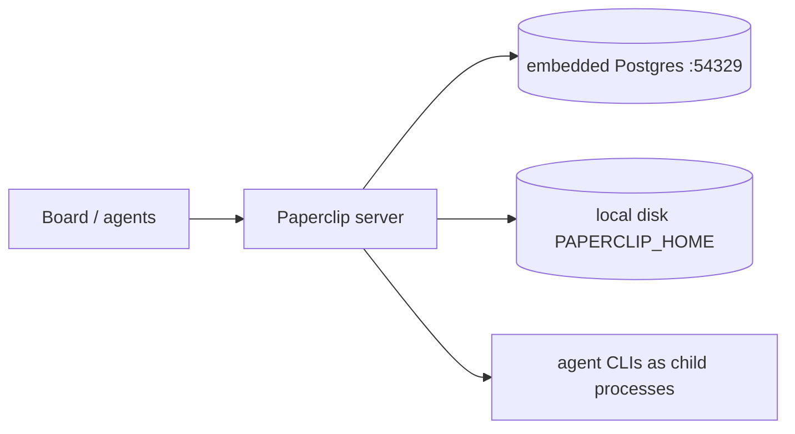
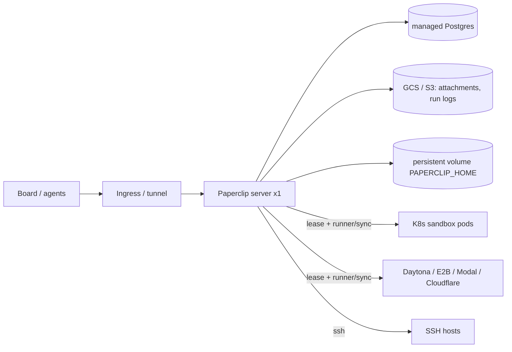
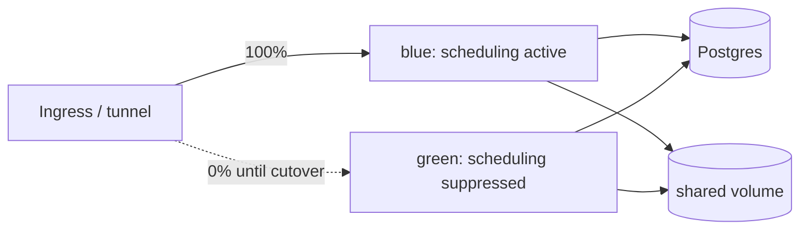
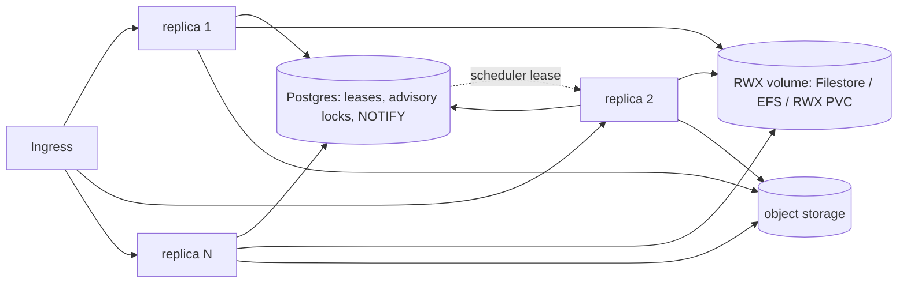

# Distributed Deployment Architectures

Status: proposal · Date: 2026-11-11

This document defines the supported and planned topologies for running
Paperclip across more than one machine. It is additive to `docs/deploy/*` and
`doc/DEPLOYMENT-MODES.md`; it does not replace them.

"Environment" means two different things here, and the design keeps them apart:

- **Server environment**: where the Paperclip control plane runs and how it is
  promoted (dev → staging → prod).
- **Execution environment**: the `environments` table
  (`packages/db/src/schema/environments.ts`), the place where agent CLIs
  actually run (`local | ssh | sandbox | plugin`).

## 1. Two axes

Distribution happens along two independent axes:

1. **Control plane** — how many Paperclip server processes share one database.
2. **Execution plane** — where agent runs execute, chosen per run by
   `server/src/services/heartbeat/environment-selection.ts` (low-trust issue
   environment → `agents.defaultEnvironmentId` →
   `instance_settings.defaultEnvironmentId` → local), with
   `PAPERCLIP_EXECUTION_MODE=kubernetes` and the managed-sandbox-only setting
   as overrides.

Today the execution plane is already distributed. The control plane is not:
every shipped topology runs exactly one server process per database.

## 2. Control-plane topologies

| ID | Topology | State | Code change |
|---|---|---|---|
| T0 | Single node, embedded Postgres | supported | none |
| T1 | Single server + managed Postgres + object storage + remote execution | supported | none |
| T2 | Active/passive (blue/green) on one database | supported, with restart at cutover | none (live flip needs §6) |
| T3 | N API replicas + singleton scheduler + shared volume | **blocked** | fencing (§6) |
| T4 | Cell per tenant (isolated stack) | supported (Cloud model) | none |

### T0 — Single node

- `docker/docker-compose.quickstart.yml` or a local install.
- For evaluation and personal use. No HA, no backups beyond
  `PAPERCLIP_DB_BACKUP_*`.

### T1 — Single server, distributed execution (recommended today)

- One server. Agents run off-host through execution environments, so the
  server is not the compute bottleneck.
- Required config:
  - `DATABASE_URL` (Cloud SQL / RDS / any Postgres 17).
  - `PAPERCLIP_STORAGE_PROVIDER=s3` + `PAPERCLIP_STORAGE_S3_*` (GCS via its S3
    interoperability endpoint).
  - `RUN_LOG_S3_*` to mirror run logs.
  - `PAPERCLIP_SECRETS_PROVIDER` (`aws_secrets_manager` is implemented;
    `gcp_secret_manager` and `vault` are stubs — use `local_encrypted` with
    `PAPERCLIP_SECRETS_MASTER_KEY` from the platform secret store on GCP).
  - `PAPERCLIP_EXECUTION_MODE=kubernetes` + `PAPERCLIP_K8S_*`, or a sandbox
    provider plugin, or `ssh` environments.
  - `PAPERCLIP_RUNNER_PUBLIC_URL` when the experimental runner is used; the
    sandbox must reach the server outbound
    (`doc/architecture/paperclip-runner-daytona-networking.md`).
- Scale limit: one server's CPU/memory for orchestration, live events and
  workspace sync. Recovery time = restart time of one process.

### T2 — Active/passive (blue/green)

- Green boots passive with `HEARTBEAT_SCHEDULER_ENABLED=false`. In that mode
  the heartbeat service is not constructed at all (`server/src/index.ts`,
  `const heartbeat = config.heartbeatSchedulerEnabled ? … : null`), so green
  neither reaps orphaned runs nor schedules wakeups. It still runs the
  environment-lease cleanup sweep and a few connector housekeeping sweeps
  (external objects, GitHub polls), which are already safe to run twice. Green can serve API reads for smoke tests.
- The flag is read at boot, so passive → active is a **restart** of green with
  the flag on. There is no live flip today.
- `resolveHeartbeatSchedulingSuppression` (`heartbeat.ts`) is a different
  mechanism: it only triggers for worktree instances, a database restore in
  progress, or a process-local task drain. It is not a blue/green switch.
- Cutover:
  1. Start green passive; health-check `/api/health` and smoke-test.
  2. Drain blue (task drain stops new admissions) and wait for live runs to
     settle.
  3. Stop blue.
  4. Restart green with the scheduler enabled; its startup recovery now owns
     every run.
  5. Route traffic to green. If verification fails, stop green and start blue
     again (automatic rollback).
- The window between steps 3 and 4 has no scheduler. API traffic can stay up
  on green; scheduled wakeups catch up at green's startup.
- Both instances must never run with the scheduler enabled at the same time
  until §6 ships: the second one would reap the first one's runs by PID.

### T3 — Multi-replica (blocked until fencing ships)

- Any replica serves API and WebSocket traffic; exactly one holds the
  scheduler lease.
- Requires the work in §6. Do not run `replicas > 1` before it lands.
- `PAPERCLIP_HOME` must be a shared RWX volume, because the server's disk is
  the authoritative copy of execution workspaces even for sandbox runs
  (`packages/plugins/sandbox-providers/SANDBOX-REQUIREMENTS.md`). The
  alternative — run affinity to a replica — gives no takeover on failure.
- Risk: git worktrees on NFS (Filestore/EFS) are slower and sensitive to lock
  files; measure workspace setup time before committing to T3 at scale.

### T4 — Cell per tenant

- One isolated stack (T1 or T2) per tenant, as Paperclip Cloud does with its
  warm pool (`doc/DEPLOYMENT-MODES.md`, "Paperclip Cloud warm-pool identity").
- Scales by count of stacks, not replicas. Strongest isolation; operational
  cost grows with tenants. Combine with T1 inside each cell.

## 3. Execution plane

| Driver | Where agents run | Server ↔ environment | Fits |
|---|---|---|---|
| `local` | server host, child processes | in-process | T0 only |
| `ssh` | remote host | SSH + `remoteWorkspacePath` | T1–T4, fixed fleets |
| `sandbox` | provider sandbox (K8s, Daytona, E2B, Modal, Cloudflare, Novita, CreateOS, exe.dev) | lease + runner + sync in/out + duplex | T1–T4, elastic |
| `plugin` / runner | `paperclip-runnerd` in the environment | outbound WebSocket to `/api/runner/v1/connect/:runId` | T1–T4, experimental |

- Leases (`environment_leases`) are company- and run-scoped; policies
  `ephemeral | reuse_by_environment | reuse_by_execution_workspace |
  retain_on_failure` decide cost vs. warm-start.
- Provisioning at boot: `PAPERCLIP_EXECUTION_MODE=kubernetes` creates the
  Kubernetes environment for every company
  (`server/src/services/execution-policy-bootstrap.ts`); the `environments`
  section of `PAPERCLIP_MANAGED_CONFIG` creates the managed sandbox row
  (`server/src/services/managed-environments.ts`). This is the hook for
  "provision the environment with the deployment": IaC sets these variables,
  the server creates the rows.
- Kubernetes provider: backends `sandbox-cr` or `job`, per-tenant namespaces,
  NetworkPolicy/Cilium egress, optional kata `runtimeClass`
  (`packages/plugins/sandbox-providers/kubernetes/README.md`).

## 4. Platform matrix

| | VM + Cloudflare | GCP | AWS | Generic Kubernetes |
|---|---|---|---|---|
| T0 | quickstart compose | — | — | — |
| T1 | compose/quadlet + external Postgres + cloudflared + Access | GKE or VM + Cloud SQL + GCS + PD | ECS Fargate + RDS + EFS + S3 (`docker/ecs-task-definition.json`) | Helm, `replicas: 1`, RWO PVC |
| T2 | two compose projects, tunnel route flip | GKE two Deployments / MIG + LB backend swap | ECS blue/green (CodeDeploy) or two services + ALB weights | Helm two releases + Service selector flip |
| T3 | not recommended | GKE + Filestore | EKS/ECS + EFS | Helm + RWX PVC |
| Execution | ssh, external sandbox providers | K8s in-cluster (GKE), Daytona/E2B | K8s (EKS), Daytona/E2B | K8s in-cluster |
| Secrets | `local_encrypted` + master key in host secret | `local_encrypted` + Secret Manager-mounted master key | `aws_secrets_manager` | `local_encrypted` + K8s Secret / External Secrets |

IaC layout (to be built, one core per concern instead of four copies):

- `deploy/helm/paperclip/` — portable core used by GKE, EKS and generic K8s.
- `deploy/terraform/gcp/`, `deploy/terraform/aws/` — managed services; install
  the chart (EKS/GKE) or extend the ECS task definition.
- `deploy/vm-cloudflare/` — compose/quadlet + cloudflared + blue/green script.

## 5. Server environments: dev → staging → prod

- One database per environment; never share Postgres across environments.
- Same image digest promoted across environments; only values/tfvars differ.
- Order: commit → push → CI builds image → deploy staging → verify → deploy
  prod with blue/green (T2). Rollback is automatic on failed verification.
- Execution environments are per server environment too: staging uses its own
  sandbox namespace/provider project so test runs cannot touch prod leases.
- Migrations: `PAPERCLIP_MIGRATION_AUTO_APPLY=true` only on the instance that
  will become active; migrations must stay backward compatible with the
  previous image for the duration of a blue/green window.

## 6. What blocks multiple server processes

Two live processes on one database already happen during every blue/green
cutover, so this is a deploy-safety problem, not only a scaling one.

| # | Process-local state | Location | Required change |
|---|---|---|---|
| 1 | Orphan reaping by PID liveness (`process.kill(pid, 0)`) | `server/src/services/heartbeat/recovery.ts` (`reapOrphanedRuns`) | Record owner instance + lease generation on runs; reap other instances' runs only when their lease expired. Reuse `controllerGeneration` from native recovery. |
| 2 | Scheduler timers | `server/src/index.ts` heartbeat ticks, `services/work-scheduler.ts` | Database-row leader lease (pattern: Discord gateway lease in `services/chat-channels.ts`). |
| 3 | Per-agent start lock in a `Map` | `server/src/services/agent-start-lock.ts` | `pg_advisory_xact_lock` (pattern: `execution-workspace-lifecycle-lock.ts`). |
| 4 | Live events via `EventEmitter` | `server/src/services/live-events.ts` | Cross-replica fan-out with `LISTEN/NOTIFY`, or sticky sessions as a stopgap. |
| 5 | Workspaces, worktrees, plugin tree, cleanup spool on local disk | `PAPERCLIP_HOME` | Shared RWX volume (T3) or affinity. |
| 6 | Passive/active is boot-time only | `HEARTBEAT_SCHEDULER_ENABLED` in `server/src/config.ts` | Covered by item 2: with a scheduler lease every replica runs the heartbeat service and only the leader schedules, so blue/green needs no restart. |

Existing coordination that already works across processes: advisory locks,
`for update` row locks in the wake queue, compare-and-set run claims in
`modules/run-dispatch`. No Redis is needed.

`doc/plans/2026-10-08-instance-sleep-and-scheduler-inventory.md` already notes
that multi-replica support requires shared fencing; this section is that work
item made concrete.

## 7. Recommendation

1. Run **T1** now on every platform, with agents on the Kubernetes or a hosted
   sandbox provider. It needs no code change.
2. Use **T2** for production deploys, with green passive until blue stops.
3. Ship §6 items 1–4, then enable **T3** where load or availability requires
   it.
4. Use **T4** when tenants need hard isolation.

## 8. Verification

- T1/T2: `/api/health` on the target instance; start a run from the board UI
  and confirm it lands in the expected execution environment lease.
- T3 (after §6): a two-instance integration test where instance B must not
  reap instance A's live run; then a UI failover check: start a run, kill the
  owning replica, confirm the scheduler lease moves and the run is recovered,
  not reaped, by the new owner.
- IaC: `helm lint`/`helm template` per values file, `terraform validate`,
  `docker compose config`. No `apply` in CI.
